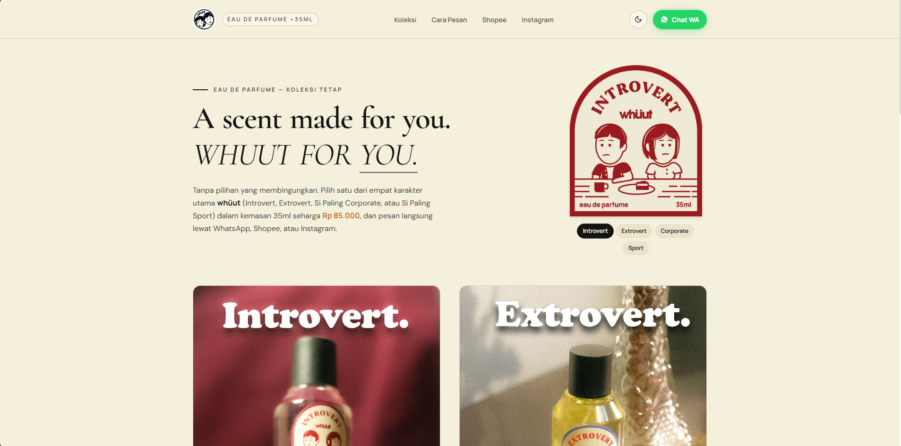
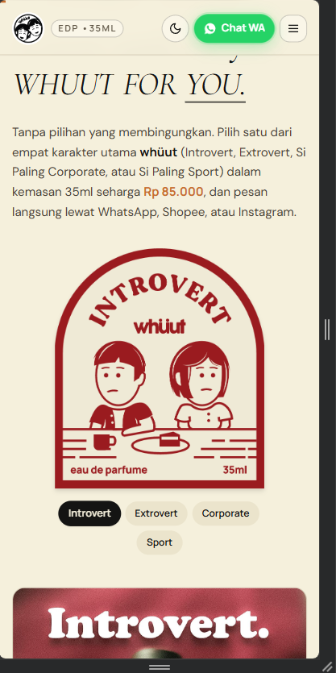

# whüut — Official Fragrance Catalog Website

> *An official interactive product catalog website for whüut Eau De Parfume (35ml), featuring direct ordering via WhatsApp, Shopee, and Instagram.*

---

## 📌 Deskripsi

Website katalog produk resmi untuk brand parfum **whüut**. Menampilkan koleksi 4 varian utama *Eau De Parfume (35ml)* dengan pengalaman visual yang elegan, interaktif, dan modern. 

Website ini dirancang khusus untuk mempermudah calon pembeli melihat detail aroma, piramida wangi (*fragrance notes*), serta spesifikasi kemasan, kemudian langsung melakukan pemesanan via **WhatsApp**, **Shopee Official**, maupun **Instagram**, tanpa alur keranjang belanja (*shopping cart*) dan sistem *payment gateway* yang rumit.

---

## 🌐 Demo

- **Link Website:** https://whuut-project.pages.dev/

---

## 📸 Tampilan

| Desktop View | Mobile View |
| :---: | :---: |
|  |  |

*(Catatan: Tangkapan layar dapat ditambahkan pada folder `docs/screenshots/`)*

---

## ✨ Fitur Utama

- **Stiker Label Interaktif (Hero Section)**: Pratinjau label botol transparan berkualitas tinggi yang berganti mulus (*fade crossfade*) saat memilih varian (Introvert, Extrovert, Corporate, Sport) tanpa *flicker* (*eager preloaded*).
- **Hover Foto Notes Piramida Aroma**: Efek visual transisi foto produk ke foto ringkasan notes aroma (*Top, Mid, Base*) saat kursor diarahkan pada kartu produk di desktop, serta dukungan sentuhan (*tap to view*) di perangkat mobile.
- **Popup Modal "Detail Paket"**: Dialog detail lengkap saat kartu diklik, menyajikan deskripsi mendalam, susunan notes resmi, standar keamanan pengemasan (*bubble wrap* berlapis), dan paket kelengkapan produk (*box* eksklusif & stiker varian).
- **Mode Terang & Gelap (*Light & Dark Mode*)**: Dukungan tema visual dengan transisi warna halus, disesuaikan agar kontras warna label dan foto tetap tajam di kedua mode.
- **Desain Responsif & Rapi**: Tampilan optimal di berbagai resolusi layar, dari layar HP sempit (320px–400px), tablet, hingga monitor desktop lebar, tanpa adanya *overflow* atau *horizontal scroll*.
- **Pesan Otomatis WhatsApp**: Tombol pemesanan langsung menyusun teks percakapan WhatsApp yang rapi dan terformat otomatis mencantumkan nama varian, ukuran, konsentrasi parfum, dan harga resmi.

---

## 🛠️ Teknologi & Dependensi

Website ini dibangun menggunakan ekosistem React modern yang cepat dan ringan:

- **[React](https://react.dev/)** (`^18.3.1`) & **React DOM** (`^18.3.1`) — Library UI komponen
- **[Vite](https://vitejs.dev/)** (`^5.4.11`) — Frontend build tool & development server berkecepatan tinggi
- **[Tailwind CSS](https://tailwindcss.com/)** (`^3.4.17`) — Utility-first CSS framework untuk styling responsif
- **[Lucide React](https://lucide.dev/)** (`^0.468.0`) — Ikon antarmuka modern yang bersih dan ringan
- **[Autoprefixer](https://github.com/postcss/autoprefixer)** (`^10.4.20`) & **[PostCSS](https://postcss.org/)** (`^8.4.49`)
- **Tipografi Google Fonts**:
  - *Cormorant Garamond* (Judul editorial, nama produk, tagline)
  - *DM Sans* (Deskripsi, teks informasi, fragrance notes)
  - *Manrope* (Navigasi, tombol, badge, elemen UI)

---

## 🚀 Cara Menjalankan Proyek

Pastikan Anda telah menginstal [Node.js](https://nodejs.org/) (versi 18 ke atas direkomendasikan).

### 1. Instalasi Dependensi
```bash
npm install
```

### 2. Menjalankan Server Pengembangan Lokal
```bash
npm run dev
```
Buka browser pada alamat lokal yang muncul di terminal (biasanya `http://localhost:5173/`).

### 3. Membangun Proyek untuk Produksi
```bash
npm run build
```
Hasil kompilasi siap rilis akan disimpan di dalam folder `dist/`.

### 4. Pratinjau Hasil Build
```bash
npm run preview
```

---

## ⚙️ Cara Mengubah Pengaturan Toko

Semua data konfigurasi toko dan katalog produk dikelola secara terpusat di dalam file `src/App.jsx`:

### 1. Konfigurasi Kontak & Media Sosial (`STORE_CONFIG`)
Cari objek `STORE_CONFIG` pada bagian atas file `src/App.jsx`:

```javascript
const STORE_CONFIG = {
  brandName: 'whüut',
  whatsappNumber: '628xxxxxxxxxx', // Nomor WhatsApp dengan kode negara 62 (tanpa tanda '+', spasi, atau angka 0 di depan)
  shopeeUrl: 'https://shopee.co.id/username-toko',
  instagramUrl: 'https://instagram.com/username-toko',
  instagramHandle: '@username-toko',
};
```
> ⚠️ **Catatan Penting Keamanan**: Pastikan nomor WhatsApp ditulis dalam format internasional angka murni (contoh: `'628123456789'`). Nomor pada repositori ini adalah nomor WhatsApp bisnis publik brand whüut dan dipakai atas izin pemiliknya. Jika memakai proyek ini sebagai template, ganti dengan nomor Anda sendiri.

### 2. Data Koleksi Parfum (`PERFUMES`)
Daftar produk disimpan dalam array `PERFUMES` di `src/App.jsx`. Anda dapat memperbarui data berikut untuk setiap varian:
- `name` & `tagline`: Nama varian dan kalimat *tagline*.
- `price`: Nilai angka harga resmi (contoh: `85000`).
- `description`: Paragraf penjelasan karakter dan cerita aroma.
- `notes`: Rincian `top`, `middle`, dan `base` notes.
- `image` & `hoverImage`: Path foto produk utama dan foto notes di folder `public/images/`.

---

## 📂 Struktur Folder

```text
Whuut Project/
├── docs/
│   └── screenshots/          # Tangkapan layar aplikasi untuk dokumentasi
│       ├── .gitkeep
│       ├── desktop.png       # (Opsional) Screenshot desktop
│       └── mobile.png        # (Opsional) Screenshot mobile
├── public/
│   └── images/               # Aset foto katalog, label transparan, dan logo
│       ├── label-introvert.png
│       ├── label-extrovert.png
│       ├── label-corporate.png
│       ├── label-sport.png
│       ├── introvert.jpg
│       ├── introvert-hover.jpg
│       ├── ...
│       └── logo-whuut.jpeg
├── src/
│   ├── App.jsx               # Komponen utama aplikasi, STORE_CONFIG & data PERFUMES
│   ├── index.css             # Konfigurasi Tailwind & gaya global
│   └── main.jsx              # Entry point aplikasi React
├── index.html                # Dokumen HTML utama & pemanggilan Google Fonts
├── package.json              # Dependensi & skrip proyek
├── tailwind.config.js        # Konfigurasi Tailwind CSS (screens, colors, fonts)
├── vite.config.js            # Konfigurasi Vite & React plugin
└── .gitignore                # Berkas pengecualian Git
```

---

## 📄 Hak Cipta & Kepemilikan Aset

Seluruh hak cipta atas logo, foto produk katalog, karakter ilustrasi, stiker label, dan materi kreatif lainnya adalah milik eksklusif brand **whüut**. Aset visual di dalam repositori ini **tidak diperkenankan untuk disalin, diperjualbelikan, atau digunakan kembali** untuk kepentingan komersial maupun non-komersial lain tanpa izin tertulis dari pemilik brand.

